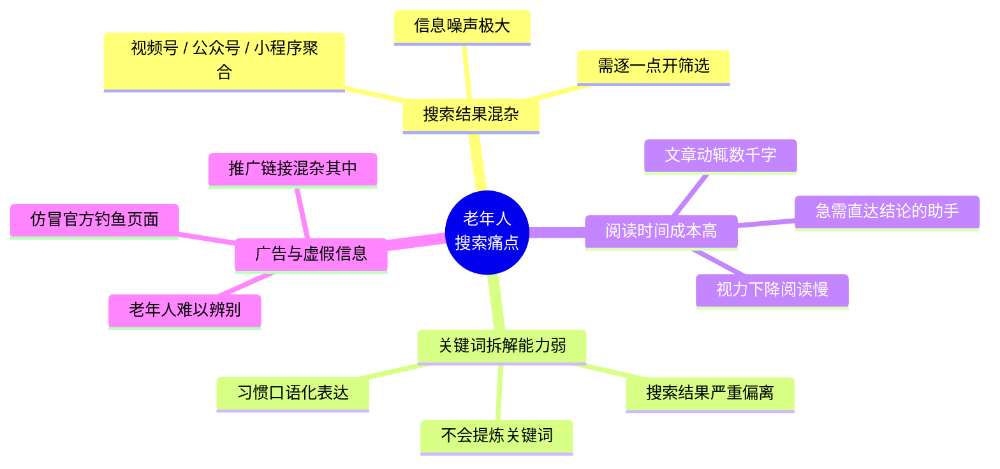
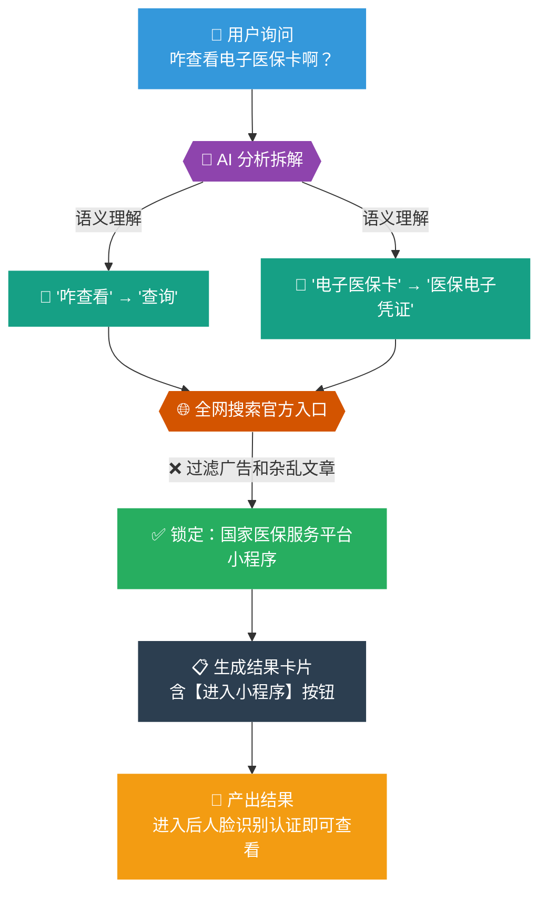
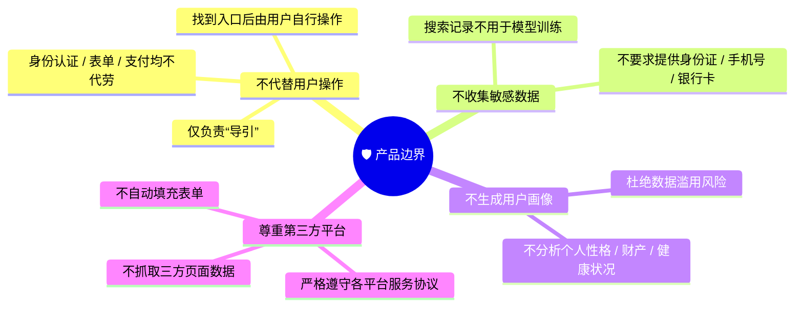

# 🧭 课题二：微信 AI 领航导引助手产品设计报告

---

## 一、背景与痛点分析

微信公众号的文章生态极为丰富，内容质量整体较高，涵盖医疗健康、政务服务、生活资讯等老年人高频关注的领域。然而，现有的搜索体验对老年群体并不友好，具体表现在以下几个方面：

- 搜一搜功能将多种形式的内容聚合展示，老年用户需要看完数篇文章才能总结出真正需要的答案，信息噪声极大。
- 老年用户习惯以口语化方式表达需求，例如"我想知道怎么查医保卡余额"，而不是直接输入"医保卡余额查询"，导致搜索结果与预期严重偏离。
- 优质的公众号文章大多篇幅较长，对于视力下降、阅读速度较慢的老年群体而言，浏览全文的时间成本很高。
- 搜索结果中常混杂着推广链接或者过时失效的内容，老年用户容易受到误导，存在信息安全风险。

### 痛点思维导图

---

## 二、产品介绍

**AI 领航导引助手**是一款专为老年群体设计的微信内嵌式智能搜索辅助工具，核心定位是"帮用户找到正确的门"。

本产品对标 [Google Web Guide Search](https://labs.google.com/search/experiment/34)，能够将老年人口语化的输入句子自动拆解成精准关键词进行搜索，并对搜索到的文章和视频内容进行理解与整合，最终以简洁明了的**功能卡片**形式呈现结果，降低用户的认知负担。与传统搜索不同，本产品不要求用户掌握任何搜索技巧，只需像和人说话一样描述需求，剩下的交给 AI 来完成。

### 整体流程

1. **输入：** 老年用户以语音或文字方式输入自然语言问题，系统自动将语音消息转换为文字。
2. **理解：** AI 模型对输入进行语义分析，识别用户真实意图，提取核心关键词并进行同义词扩展（如"咋查"→"查询"，"电子医保卡"→"医保电子凭证"）。
3. **搜索：** 基于提取的关键词，在微信生态内及外部权威网站进行联网搜索，获取相关文章、官方公告及小程序入口。
4. **去噪：** AI 模型识别并过滤广告链接、低质内容及疑似虚假信息，优先保留来自政府、医疗机构等权威来源的内容。
5. **整合&呈现：** 将筛选后的关键信息组织为结构化卡片，以简洁且全面的形式呈现，让用户无需阅读长文即可直接采取行动。

### 创新技术
与微信已有的AI搜索不同，本产品更贴合老年人对微信搜索的使用方式，已有的微信搜索已经做到能够根据搜索关键词提取有效的数据，而我们的新产品将**在理解和转化方面进行针对性的训练**，让AI搜索模型能够真正和老年人的思路同频，搜索到老人想要的结果，并且最大化**节约时间和精力成本**。

---

### 实际应用蓝图

---

## 三、产品边界与隐私保护
- **明确产品定位**
    - 我们的产品仅负责指引功能入口，找到路径后由用户自行完成后续动作（不属于搜索的范畴）。
    - 涉及身份认证、表单填写及支付等关键环节，系统均不代劳。
- **信息安全保护**
    - 不要求用户提供身份证、手机号或银行卡等隐私数据。
    - 明确搜索记录不被用于模型训练，从源头保障隐私。
- **保护用户隐私**
    - 我们不会分析用户的个人性格、财产状况或健康信息或者生成任何形式的用户画像。  
- **尊重第三方生态**
    - 我们的产品不抓取第三方页面数据，更不会不提供自动填充表单等干扰第三方平台运行的功能。
    - 我们严格遵守各平台的服务协议与使用规范。

